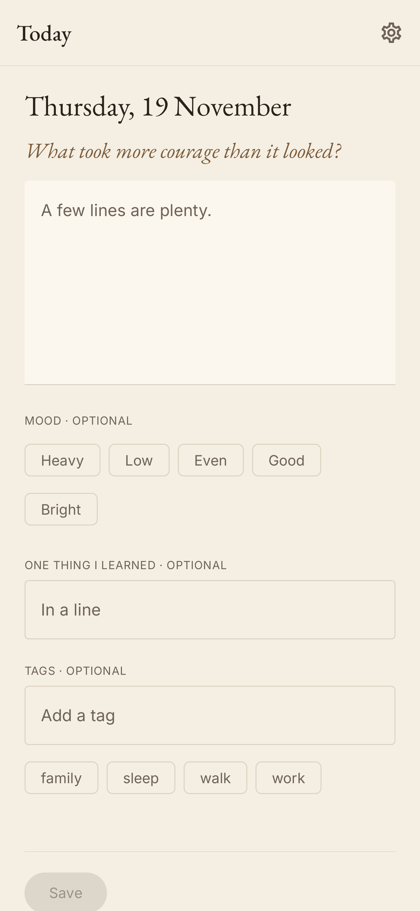
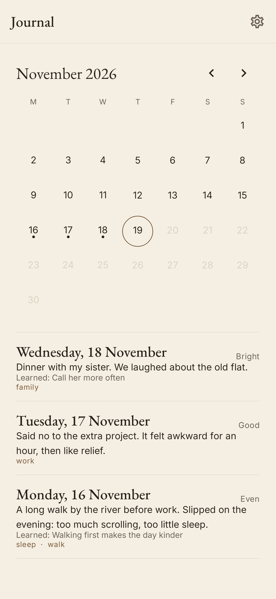
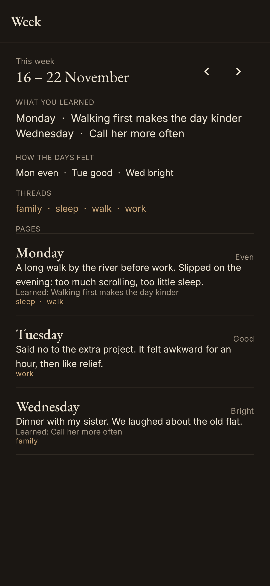

# Lyceum

A quiet daily reflection journal for Android.

One short prompt a day. Write a few lines, note your mood if you like, and one thing you learned.
After you save, a short passage from Aristotle chosen to suit the day.

- Free, no ads, no accounts, no analytics. Everything stays on your phone.
- No streaks, no scores, no guilt.
- Calendar, search, tags and a weekly review.
- Optional gentle evening reminder.
- App lock (PIN or biometric), JSON export/import.
- Optional passphrase-encrypted backup to your own Google Drive (hidden app folder).
- Optional link to a goal in [Stagira](https://github.com/admintoolcrate/Stagira).

<p>
  
  
  
</p>

## Building

Requires JDK 17+ and the Android SDK (platform 36).

```bash
./gradlew assembleDebug
```

```bash
./gradlew testDebugUnitTest
```

`RenderTest` draws the real screens, light and dark, into `app/build/screens/`; `docs/screens/` holds copies.

## Docs

- `CLAUDE.md`: project conventions.
- `docs/drive-setup.md`: registering the Google OAuth client for the optional Drive backup.
- `docs/stagira-intent.md`: the intent contract with Stagira.
- `third_party/README.md`: bundled fonts and the source of the quotations.
